<p align="center"></p>

# Oryn — turn one product photo into a short-form ad that sells

Oryn is an AI video studio for e-commerce merchants. Upload a single product photo, and Oryn writes the script, generates product-specific scenes from **your** photo, records a natural English voiceover, adds captions, music and a product card, and renders a vertical 9:16 ad ready for **TikTok, Instagram Reels and YouTube Shorts** — in two minutes for a quick cut, or about fifteen for a cinematic ad.

## The problem

Small and mid-size merchants need a steady stream of short-form video to sell online, but producing it is slow and expensive: a studio shoot, an editor, a voice artist and a week of back-and-forth for every product. Generic AI video tools don't help much either — they drop random stock footage next to your product, hallucinate a different-looking product, or demand a dozen API keys before anything renders.

## The idea

Make the merchant's own photo the single source of truth and automate everything around it:

- **Product-locked scenes.** Every shot is generated image-to-image from the uploaded photo, so the product in the ad is *the* product — same shape, colours, logo and packaging — placed into the scenes the script calls for (a messy kitchen, a hand rinsing it at the sink, a hero shot on a counter, someone enjoying it outdoors). No stock libraries, no lookalikes.
- **Zero setup for the merchant.** The deployment carries its own OpenAI key. A merchant opens Oryn, drops a photo, types the product name and a few selling points, and presses one button.
- **Two finishing levels, one flow.**
  - **Free quick cut** — 5–7 shots, one scene each, free voiceover, captions, music, product card, cross-fades. ~2 minutes, a few cents of API usage.
  - **Cinematic ad** — an 8–10 shot story arc (hook → problem → reveal → use → payoff → CTA) with director notes per shot, two candidate frames per shot judged by an LLM, extra camera positions rendered as eased push-in / drift / dissolve footage, a hook title card, synthetic hits on cuts and a tighter music duck under the voice. ~15 minutes, roughly $7–8 of API usage.
- **Director mode when you want control.** Storyboards, per-shot regeneration, QC with targeted retakes, A/B variants, batch production, platform framing and export, all still there behind the one-click path.

## Demo

**Hosted demo: [oryn-nu.vercel.app](https://oryn-nu.vercel.app)** — the prototype showcase with both generated ads playable in the browser, the input photo, the pipeline walkthrough and UI screenshots.

| Input photo | Free quick cut (19 s) | Cinematic ad (24 s) |
|---|---|---|
| 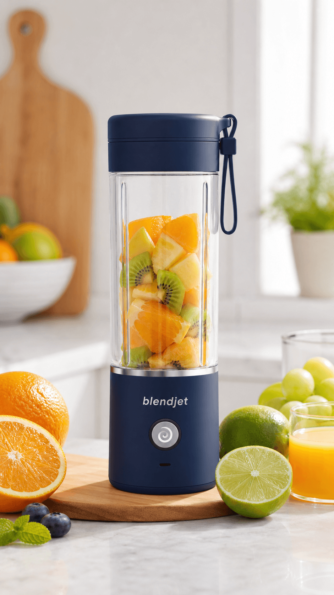 | <a href="https://oryn-nu.vercel.app/media/demo-quick-cut.mp4">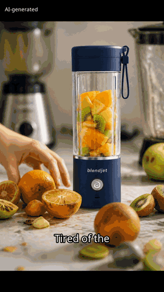</a> | <a href="https://oryn-nu.vercel.app/media/demo-cinematic-ad.mp4">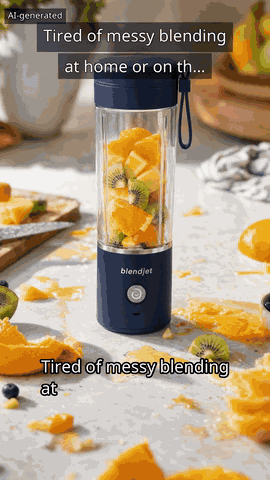</a> |

GIF previews are silent; click one to play the full MP4 with voiceover and music (also in `docs/videos/`).

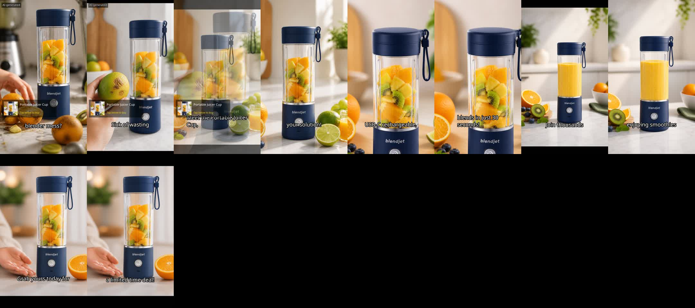 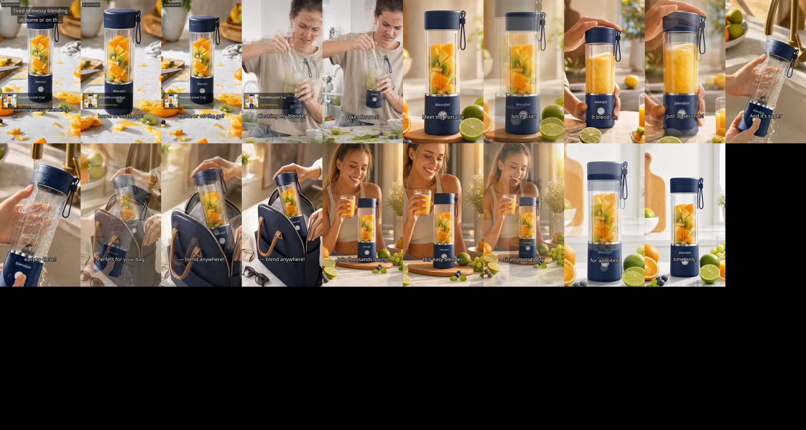

Both ads were produced end to end by Oryn from the single photo on the left, with no manual editing. Watch them at [oryn-nu.vercel.app](https://oryn-nu.vercel.app), or run the full app locally in one command (below).

### Screens

The interface follows the same hard-edged system as the [demo page](https://oryn-nu.vercel.app): grid-paper background, black rules and offset shadows, Anton display type, Space Grotesk / Space Mono text, red and acid-yellow accents. Every option in Director mode is still exactly where it was.

| Start — drop a photo, pick Free quick cut or Cinematic ad | Script — the voice-over and the two finishing paths | Video — timeline and compose settings |
|---|---|---|
| 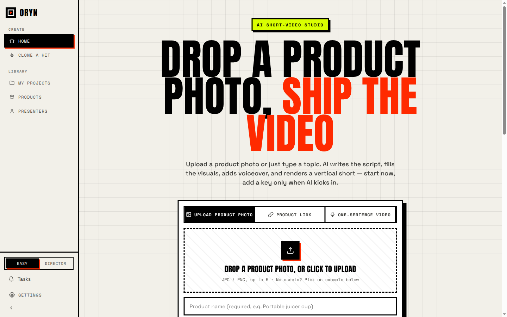 | 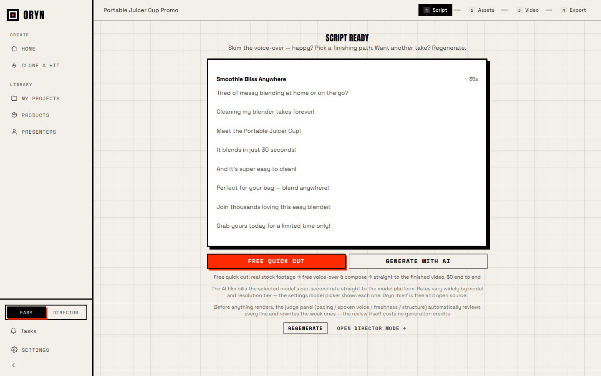 | 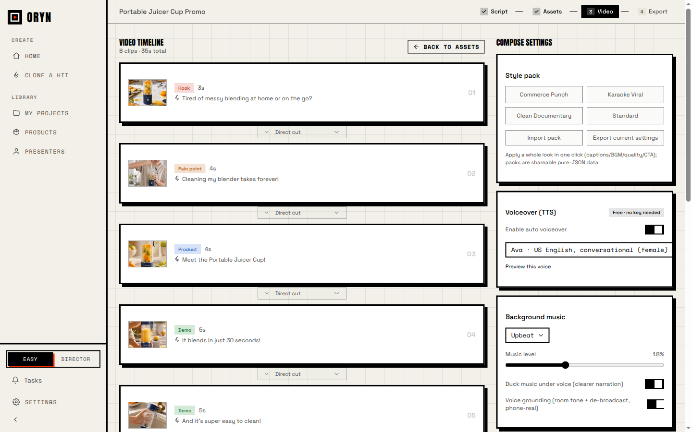 |

| Projects — every render with its product | Export — finished 9:16 ad, platform framing | Settings — keys optional, server key by default |
|---|---|---|
| 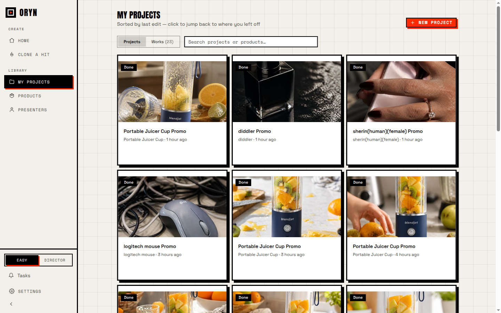 | 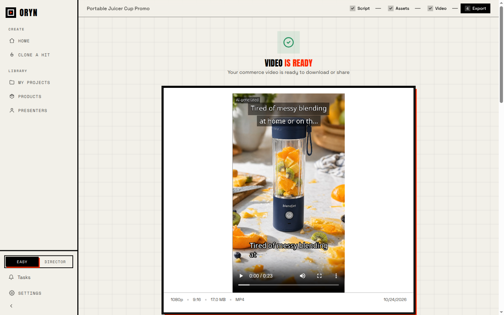 | 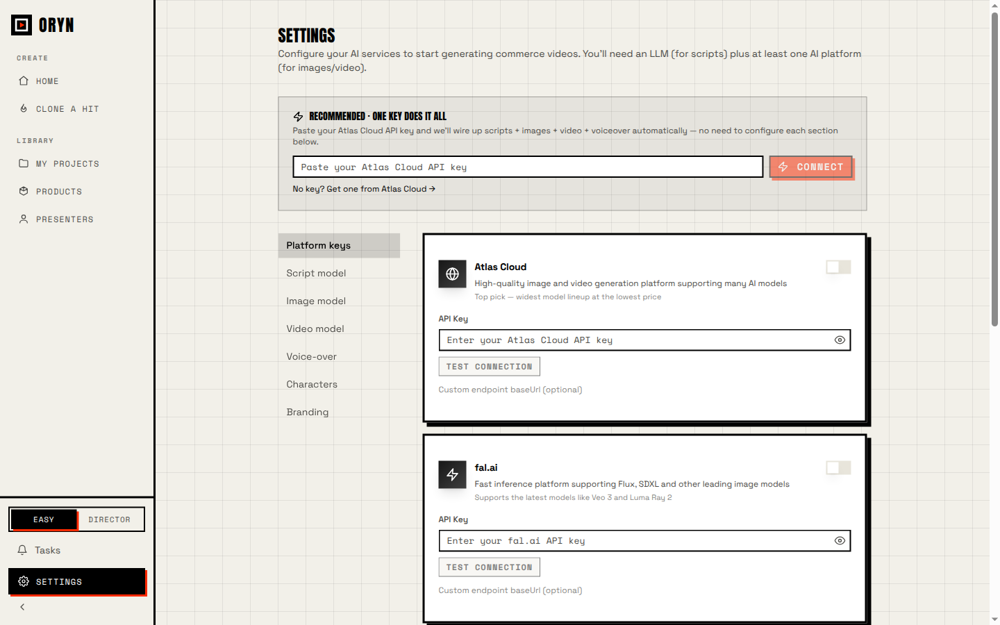 |

## How a render works

```
photo + name + selling points
   → script (GPT-4o-mini): 5–10 shots with filmable scene descriptions, English voice lines
   → judge pass: pacing / voice / structure review and rewrites (best effort)
   → AI scenes (GPT Image, image-to-image from the product photo)
        quick: 1 scene per shot
        cinematic: 2 candidates → LLM pick → 2 extra camera positions per shot
   → voiceover (Microsoft Edge neural voices, English, default "Ava")
   → compose (FFmpeg): camera moves, dissolves, bold captions, music with voice ducking,
     product card, hook card, cut SFX, "AI-generated" badge → 1080×1920 H.264/AAC
```

If a scene can't be generated, the shot falls back to the merchant's own photo with a camera move — never to unrelated footage.

## Technology stack

| Layer | Tools |
|---|---|
| App | Next.js 16 (App Router, Turbopack), React 19, TypeScript 5, Tailwind CSS 4, Zustand |
| AI | OpenAI GPT-4o-mini (script, judge, vision candidate pick), OpenAI GPT Image 2 (image-to-image scenes); optional fal.ai / Replicate / Atlas Cloud providers for paid video models |
| Voice | Microsoft Edge neural TTS (free, native English voices), optional OpenAI TTS |
| Rendering | FFmpeg (zoompan camera moves, xfade dissolves, drawtext captions, sidechain ducking, synthesized SFX), local and offline |
| Music | Free CC-licensed tracks (Wikimedia Commons; Jamendo with a client id) |
| Data | SQLite via better-sqlite3 + Drizzle ORM; files on disk |
| Interface | Next.js App Router, Tailwind CSS 4, shadcn/ui primitives, Anton + Space Grotesk + Space Mono |
| Delivery | Docker image, Electron desktop build, CLI, MCP server and agent skill sharing the same pipeline |
| Quality | Vitest (1,200+ tests), ESLint, TypeScript strict, GitHub Actions CI |

## Run it

**Docker (recommended):**

```bash
docker build -t oryn .
docker run -d --name oryn -p 3000:3000 \
  -v oryn-data:/data \
  -e OPENAI_API_KEY=sk-... \
  oryn
```

Open http://localhost:3000. With `OPENAI_API_KEY` set on the server, merchants need no settings of their own; anyone can still paste a personal key under Settings to override it.

**From source:**

```bash
pnpm install
OPENAI_API_KEY=sk-... pnpm dev      # http://localhost:3000
pnpm build && pnpm start            # production
```

Requirements: Node 20+, pnpm 10+, FFmpeg on the PATH (the Docker image bundles it).

**Optional environment variables**

| Variable | Purpose |
|---|---|
| `OPENAI_API_KEY` | Server-managed key for scripts, scene generation and candidate judging |
| `ORYN_LLM_MODEL`, `ORYN_VISION_MODEL` | Override the default `gpt-4o-mini` |
| `ORYN_IMAGE_MODEL` | Override the default `gpt-image-2` |
| `JAMENDO_CLIENT_ID` | Curated free background music |
| `APP_DATA_DIR` | Where projects, uploads and renders are stored (default `./data`, `/data` in Docker) |

## Project structure

```
src/app/            Next.js routes: start, projects, project/[id]/{script,assets,video,export}, settings, batch, media-lab, presenters, products
src/app/api/        REST API: projects, scripts, pipeline, compose, stock, TTS, AI providers, server-config
src/lib/            Pipeline runner, script engine and prompts, product-scene prompts, providers, TTS, asset persistence
src/lib/video-composer/  FFmpeg composition: clips, motions, frame sequences, captions, overlays, audio mix, SFX
src/components/     UI components (Cosmos-style light theme)
mcp/, bin/, skills/ MCP server, CLI and agent skill
electron/           Desktop build
docs/               Demo videos, screenshots, guides
```

## Development

```bash
pnpm lint
pnpm vitest run
npx tsc --noEmit -p .
```

## License

License to be announced. All rights reserved until a license file is added.
